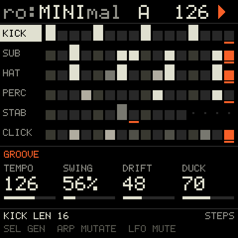

# ro:MINImal

Firmware für den **M-VAVE FM-1**: ein Groove-Synthesizer für Rominimal und Microhouse.
Sechs feste Stimmen, ein polymetrischer Step-Sequencer mit Chance pro Step, Swing, Drift und ein
Groove-Generator. Dazu Tempo-Delay, Reverb und Kick-Ducking.

**Ohne Gerät ausprobieren:** https://g0rst.github.io/ro-MINImal/ (dort im FM-1-Emulator testen: das echte
Firmware-Paket in fm1-emu)

**Handbuch:** https://g0rst.github.io/ro-MINImal/manual.html, in Englisch, Deutsch und Rumänisch (Quelle:
`manual/build.py`).

**Im Browser testen:** `docs/index.html` öffnen. Die Seite enthält denselben C-Kern wie die Firmware
(als WebAssembly; online: https://g0rst.github.io/ro-MINImal/testseite.html) und bildet Display, Regler, Tasten und die 27 Keys des FM-1 in der Anordnung des Geräts nach.

K1 bis K4 heißen am Gerät KNOB1 bis KNOB4, ALGO und PRESET heißen ALGORITHM und PRESETS.

## Stand

| Teil | Zustand |
| --- | --- |
| Kern (`app/core/romi.c`): Klang, Sequencer, Generator, Display | läuft, Host-Tests grün (`tests/run_tests.sh`) |
| Browser-Testseite (`docs/index.html`) | läuft (WebAssembly aus demselben Kern) |
| FM-1-Anbindung (`app/app.c`) im Host-Simulator von fm1-base | läuft, Testskript `app/tests/basic.txt` grün (inkl. Speichern und Neustart) |
| Firmware-Paket `.fwsc` für das Gerät | wird bei jedem Push von GitHub Actions gebaut (Artefakt `firmware` im Lauf „build“, und auf der Projektseite); besteht die Prüfungen von fm1-base (Image 107 KB, RAM 42 von 96 KB) |
| Lauf auf einem echten FM-1 | **noch nicht getestet** |

Das Paket ist gebaut, aber nie auf einem Gerät gestartet. Offen bis zum ersten Lauf auf der Hardware: CPU-Last des Renderers, ob der Audio-Pfad aus dem RAM laufen
muss (`PLAT_RAM_CODE` in fm1-base), die Geschwindigkeit des Display-Neuzeichnens pro Step und der Klang über
Lautsprecher und Kopfhörer des Geräts.

**Vor dem Flashen lesen:** Custom-Firmware kann einen FM-1 unbrauchbar machen. Der Chip hat nur eine
Firmware-Bank und keinen Recovery-Taster; neuere Hardware-Revisionen (M-VAVE-Logo unter dem Display) vertragen
manche Custom-Firmwares nicht. Vorher auf die offizielle V15 gehen, Daten sichern und wissen, wie man
zurückkommt (Installer von fm1-base, `base/README.md`).

## Konzept

Rominimal und Microhouse leben von wenigen Elementen, die sich kaum merklich bewegen. Daraus folgt der Aufbau:

- **Ein Groove, vier Spielarten.** Pattern A ist der Groove; B, C und D werden immer aus A gemacht und ziehen
  nach, sobald sich A ändert: B spielt ihn variiert (gleiche Harmonie, anderer Beat), C mit Drum-Rolls zum Takt,
  D in einer verwandten Tonart. B lässt dabei ab und zu einen Kick-Schlag weg, C pausiert die Kick oft in den
  letzten vier Steps vor dem Takt. Setzt sie in C auf 13 bis 16 aus, wird mit Chance eins zu drei die Kick eine
  andere (Grundton oder Quinte, Ausklang, Sweep, Click, Drive) – ab D in allen Patterns gleich, auch in A, bis du
  sie von Hand änderst oder Cs Pause wieder würfelt. D behält sonst die Kick von A. Mit CHAIN EVOLVE entstehen nach jeder Runde A–D neue B, C und D: ein Set,
  das sich ständig weiterentwickelt.
- **Zwei Modi (GLO zweimal: GLOBAL 2).** **LAZY** ist das oben: B bis D entstehen von selbst, gespeichert werden
  nur A und die Einstellungen. **HARD**: B bis D sind beim ersten Umschalten Kopien von A und danach eigenständig;
  bearbeitet wird das Pattern, das gerade läuft, NEW erneuert dort Spur oder (halten) Pattern, alle vier werden
  gespeichert. Zurück in LAZY bleiben die HARD-Patterns beiseite und sind beim nächsten Wechsel wieder da.
- **PLAY (GLOBAL 2, KNOB2), in beiden Modi:** LOOP spielt das Pattern weiter (oder die CHAIN von GLOBAL),
  A-D spielt A, B, C, D je vier Takte und beginnt wieder bei A, RANDOM springt alle vier Takte zu einem anderen
  Pattern. CHAIN EVOLVE erneuert in LAZY dabei alle sechzehn Takte B bis D.
- **Die Kick ist das Raster.** Vier auf dem Boden in A und D, nichts sonst ist sicher.
- **Jede Spur hat ihre eigene Looplänge** (1 bis 16 Steps). Percussion und Clicks laufen auf 7, 9, 11 oder 13
  Steps gegen die 16 der Kick. Der Takt wiederholt sich dadurch erst nach vielen Takten.
- **Jeder Step hat eine Chance** (stufenlos 1 bis 100 %), einen Akzent, eine Note und einen Ratchet (bis zu vier
  Schläge im Step). Sub und Stab haben dazu **SLIDE** pro Step (gleitet ohne neuen Anschlag vom Ton davor) und
  **GLIDE** pro Spur (Seite LINK, KNOB4: überlappende Töne gleiten).
- **Swing** verschiebt jede zweite Sechzehntel (50 bis 75 %).
- **Drift** bewegt Klangfarbe, Ausklang, Lautstärke und Mikrotiming langsam und zufällig. Die Kick bleibt
  davon im Timing unberührt.
- **Der Generator macht einen Groove, nicht sechs Würfel.** NEW erneuert nur die gewählte Spur,
  passend zu den anderen. NEW gehalten macht einen ganz neuen Groove: zuerst eine Dichte (sparsam, mittel, dicht;
  schnelle Tempi eher sparsam), dann die Spuren in einer Reihenfolge, in der jede sich auf die vorigen stützt: Die Kick ist das Raster und wird auf den Grundton gestimmt, der Stab bildet die Harmonie, der Sub rollt
  zwischen den Kicks und beginnt auf dem Grundton, die Hats sitzen auf dem Offbeat, die Percussion läuft in eigener
  Länge und so gedreht, dass sie die Kick möglichst meidet, alle Töne bleiben in der Skala. Auch die Klangfarbe von
  Hat, Percussion, Stab und Click ändert sich in passenden Grenzen; Pegel, Mix und das Fundament aus Kick und Sub
  bleiben. `ARP` verändert eine Spur um einen Schritt. UNDO nimmt alles zurück.
- **Sidechain pro Spur.** Eine Quelle (ab Werk die Kick) duckt jede Spur um deren eigenen Anteil, dazu Delay
  und Reverb. Ist die Quelle stumm, duckt sie weiter (Ghost-Kick).
- **Verknüpfte Spuren (LINK).** Die Steps einer Spur können davon abhängen, ob eine andere Spur an dieser
  Stelle tatsächlich geschlagen hat, mit ihrer Chance und ihrer eigenen Looplänge. Eine stumme Quelle wirkt
  weiter: ein unhörbares Euklid-Muster als Tor für andere Spuren.
- **Zwei Klangseiten pro Spur.** SOUND hat die vier Grundparameter der Stimme, SOUND 2 formt sie: Tonhöhe der
  ganzen Spur, Einsatz (Attack) oder die bisher festen Zeiten (Click und Pitch-Abfall der Kick, FM-Anschlag des
  Sub, Bend der Percussion), Sättigung und Bit-/Samplerate-Reduktion. Ohne Filter, deshalb günstig. Ab Werk klingt
  alles wie ohne SOUND 2.
- **Zwei LFOs pro Spur**, im Takt des Grooves, auf Klangparameter, Pegel, Pan oder Sends. Ohne Filter, deshalb
  kaum Rechenzeit: Klangparameter werden pro Schlag moduliert, Pegel, Pan und Sends einmal pro Audioblock.
- **Parameter-Locks und Mikrotiming.** Jeder Step kann eigene Klangwerte haben (bis zu 32 Locks pro Pattern) und
  bis zu 7/16 Step früher oder später kommen; die ganze Spur dazu noch einmal bis zu 8/16.

### Stimmen

| Spur | Synthese | K1 bis K4 auf der Seite EDIT |
| --- | --- | --- |
| KICK | Sinus mit Pitch-Hüllkurve, Click, Soft-Clipper | TUNE, DECAY, PUNCH, DRIVE |
| SUB | Sinus mit kurzem FM-Anschlag und etwas Drive, Legato-Glide; eine Oktave über dem Grundton (F2, gut hörbar auch auf kleinen Boxen), SOUND 2 PITCH -12 für den tiefen Sub; duckt nur halb | DECAY, FM, RATIO, GLIDE |
| HAT | zwei unharmonische FM-Paare gegen Rauschen, Hochpass; Akzent öffnet | DECAY, TONE, METAL, OPEN |
| PERC | ein FM-Paar mit Pitch-Bend: Rim, Holz, Tom, Blip | DECAY, FM, RATIO, BEND |
| STAB | Dreiklang aus FM-Paaren, Tiefpass folgt der Hüllkurve | DECAY, BRIGHT, CHORD, DETUNE |
| CLICK | Rauschkorn durch resonanten Bandpass, zufällig im Stereofeld | DECAY, FREQ, RESO, SCATTER |

Effekte: Delay (1/16, 1/8, 3/16; links volle Zeit, rechts zwei Drittel), Reverb (vier Kämme, Allpässe),
Soft-Clipper in der Summe. 44,1 kHz, Blöcke zu 256 Frames.

## Bedienung

| Bedienelement | Funktion |
| --- | --- |
| PLAY | Start und Stopp |
| 16 weiße Tasten | die Steps der gewählten Spur; tippen schaltet um |
| weiße Taste halten + K1 / K2 / K3 / K4 | Note, Chance (stufenlos, 1 % pro Raste), Akzent (bei SUB/STAB: OFF, ACC, SLIDE, ACC+SLIDE), Ratchet (1 bis 4 Schläge) dieses Steps |
| weiße Taste halten + SELECT | Mikrotiming dieses Steps (bequemer auf der Seite TIMING) |
| auf Seite EDIT: weiße Taste halten + K1 bis K4 | Parameter-Lock: der Klangwert gilt nur für diesen Step |
| weiße Taste halten + SEL | Locks und Verschiebung dieses Steps löschen |
| schwarze Tasten 1 bis 6 | Spur wählen: KICK, SUB, HAT, PERC, STAB, CLICK |
| schwarze Tasten 7 bis 11 | Spur leeren, nach links, nach rechts, Spur neu (gehalten: ganzer Groove neu), Undo |
| SELECT, OCT−, OCT+ | Spur wählen |
| ALGO | Looplänge der Spur |
| PRESET | Pattern A bis D (wechselt zum nächsten Takt) |
| HOME | Seite GROOVE: Tempo (90 bis 150), Swing, Drift, Duck |
| EDIT | Seite SOUND: die vier Klangparameter der Spur |
| EDIT ein zweites Mal | Seite SOUND 2: PITCH (±24 Halbtöne), dann je Spur CLICK (Kick), FM.TIME (Sub), B.TIME (Perc) oder ATTACK (Hat, Stab, Click), DRIVE (Kick: P.TIME), CRUSH. Lockbar pro Step, Ziel für LFOs |
| ENV | Seite MIX: Pegel, Pan, Delay-Send, Reverb-Send |
| FX | Delay-Zeit, Feedback, Reverb-Größe, Dämpfung |
| FX ein zweites Mal | Seite SIDECHAIN: Quelle (Spur), Tiefe, Release, Anteil der gewählten Spur. Eine stumme Quelle duckt weiter. |
| GLO | Grundton, Skala (Moll, Dorisch, Phrygisch, Pentatonik), MIDI-Clock, CHAIN (A-B, A-C, A-D nacheinander, je vier Takte; EVOLVE: A-D und danach neue B, C, D) |
| GLO ein zweites Mal | Seite GLOBAL 2: MODE LAZY (B bis D entstehen aus A) oder HARD (vier eigene Patterns); PLAY LOOP, A-D oder RANDOM |
| SEL | kurz: Spur stumm; halten: Solo (beim Loslassen) |
| SEL halten + schwarze Tasten 1 bis 6 | jede Spur direkt stumm oder an, auch mehrere zugleich; die gewählte Spur bleibt |
| ARP | Spur leicht verändern |
| SEQ ein drittes Mal | Seite TIMING: SELECT springt von Schlag zu Schlag, eine weiße Taste wählt einen Step direkt (ohne ihn umzuschalten). K1 schiebt den gewählten Schlag, K2 die ganze Spur, zusammen bis zu eine halbe Sechzehntel früher oder später |
| LFO | Seite LFO 1 der Spur; nochmal: LFO 2. Je RATE (1/16 bis 16 Takte), DEPTH (±), TARGET (Klangparameter beider SOUND-Seiten, Pegel, Pan, Delay, Reverb), SHAPE (Sinus, Dreieck, Säge, Rechteck, Zufall) |
| REC | Tasten spielen die Spur chromatisch; bei laufendem Groove werden die Noten aufgenommen |
| SEQ | zurück zu den Steps und Seite EUCLID: Schläge, Rotation, Chance, Akzent auf jedem n-ten Schlag |
| SEQ ein zweites Mal | Seite LINK: die Steps der Spur hängen von einer anderen Spur ab. Quelle und Modus: WITH (nur mit ihren Schlägen), GAPS (nur in ihren Lücken), AFTER (einen Step danach). K3 FOLLOW: die Töne der Spur folgen den Akkorden einer anderen Spur (ab Werk: SUB folgt STAB; OFF schaltet es ab) |
| SAVE | Projekt im Flash sichern (Einstellungen und Pattern A; B bis D entstehen daraus) |
| PRESETS | Pattern A bis D, im Lauf zum nächsten Takt. Bearbeitet wird immer A, auch wenn B, C oder D läuft |
| NEW auf B, C oder D | diese Spielart neu würfeln; A bleibt |
| MASTER | Lautstärke |

LEDs: gesetzte Steps leuchten, die Looplänge glimmt, der Playhead invertiert seinen Step.
MIDI: Kanäle 1 bis 6 spielen die Spuren (Note 60 ist der Grundton), Kanal 10 eine Drum-Map.
Start und Stopp werden empfangen; Clock, Start und Stopp werden über USB gesendet. USB ist nur MIDI: Die Firmware
meldet sich nicht als Audio-Interface.

### Speicher und Last (berechnet, nicht am Gerät gemessen)

| | belegt | verfügbar | Anteil |
|---|---|---|---|
| Firmware-Image (Flash) | 120 336 B | 581 564 B (App-Slot) | 21 % |
| RAM .data + .bss | 34 312 B | 98 304 B | 35 % |
| RAM-Pool (Delay, Reverb, fm1-base) | 118 980 B | 344 064 B | 35 % |
| RAM-Code (.ram_text) | 5 100 B | 32 768 B | 16 % |
| Speicherfenster 0xB1000–0xBAFFF | höchstens 2 426 B (Einstellungen 32 B, A–D je bis 598 B) | 40 960 B | 6 % |

Last des Renderers: Instruktionen pro Sample mit callgrind gezählt (x86-64, -O2, wie der Core gebaut wird), auf
den AC79 (Kern r3, 360 MHz, Single-Precision-FPU) umgerechnet mit Faktor 1,6 bis 3,0 (mehr Instruktionen auf
einem RISC-Kern, Takte pro Instruktion, Cache-Misses beim Ausführen aus dem Flash). Budget: 8 163 Takte pro Sample.

| Fall | Instr./Sample | Last (1,6 / 2,2 / 3,0) |
|---|---|---|
| alle Spuren stumm (Delay, Reverb, Mix, Sequencer, LFOs) | 995 | 20 / 27 / 37 % |
| typischer Groove | 1 397 | 27 / 38 / 51 % |
| schlimmster Fall: jeder Step, Ratchet x4, Drive und Crush, LFOs, volle Sends | 1 648 | 32 / 44 / 61 % |

Anteile der Stimmen im schlimmsten Fall: Stab 207, Hat 173, Sub 93, Perc 87, Kick 58, Click 40 Instr./Sample. Die
Oberfläche (Zeichnen, Byte-Tausch der Streifen) kostet geschätzt 2 bis 4 %. Reserven, falls es eng wird: der zweite
Kern (fm1-base `cpu2`, z. B. Reverb oder die Hälfte der Stimmen), `cpu_clock = 396`, mehr Render-Code im RAM.
Der echte Wert kommt am Gerät aus `plat_cpu_pct`.

### Speicher

Gespeichert werden im LAZY-Modus zwei Objekte: die Einstellungen (32 Bytes, darin die Würfel für B bis D, MODE
und PLAY) und Pattern A (502 Bytes, mit 32 Locks 598 Bytes); im HARD-Modus dazu B, C und D. Ein Step belegt 3 Bytes
(das dritte ist die stufenlose Chance), Slide und Glide 3 Bytes pro Spur. Patterns der Version 13 werden weiter
geladen (ohne Slide, die Chance in vier Stufen übernommen). Locks stehen als Liste pro Pattern. Daraus folgen die Grenzen: höchstens
32 Locks pro Pattern (sonst „LOCKS FULL“), Verschiebung eines Steps ±7/16, Noten −32 bis +31 Halbtöne um den Grundton.
Ein beschädigtes Objekt lässt das andere unberührt.

Die Objekte liegen im Flash bei `0xB1000–0xBAFFF`: auf dem FM-1 im Datenbereich von fm1-base, auf dem SMK-37 im
Fenster, das das Porting-Playbook für zusätzliche Objekte vorsieht. Keins berührt die Bereiche, die auf einem der
beiden Geräte geschützt sind (Bootloader, Bluetooth, Werkskalibrierung, Werksressourcen, Schlüssel). `app/app.c`
prüft das beim Übersetzen; ein Objekt außerhalb des erlaubten Fensters bricht den Build ab.

### SMK-37

Noch nicht unterstützt. `smk37-port.yaml` hält fest, was die Regeln des Porting-Playbooks
([genkigenki/fm1-to-smk37](https://github.com/genkigenki/fm1-to-smk37)) schon entscheiden, und listet die offenen
Bedienfragen. Ein Build für das SMK-37 bricht ab, solange es keine Board-Schicht gibt. Vor jeder Installation auf
einem SMK-37: vollständige Flash-Sicherung, wie im Playbook beschrieben.

## Aufbau

    app/core/romi.h, romi.c   der ganze Synthesizer: portables C99 ohne libc und ohne Plattform-Aufrufe
    app/app.c, app.h          Anbindung an fm1-base (Audio, MIDI, Panel, Display, Speicher)
    app/fm1.toml              Build-Einstellungen für fm1-base
    app/tests/basic.txt       Testskript für den Host-Simulator von fm1-base
    base/                     fm1-base als Submodul (darin felucca-bsp): Plattform, Build, Installer
    sim/                      Browser-Testseite: wasm.c, page.html, build.sh  ->  docs/index.html
    tests/                    Host-Tests des Kerns
    manual/                   Handbuch in drei Sprachen: build.py  ->  docs/manual.html

Der Kern zeichnet das Display selbst in Streifen von 240 x 48 Pixeln (eigene 5x7-Schrift). Deshalb zeigen
Gerät, Simulator und Browser dasselbe Bild.

## Bauen und testen

    git clone --recursive https://github.com/g0rst/ro-MINImal
    tests/run_tests.sh        # Kern-Tests (cc); schreibt build/tests/groove.wav und Bildschirmfotos
    sim/build.sh              # Browser-Testseite (clang mit wasm32-Target, wasm-ld, python3)
    ./build.sh --host         # Host-Simulator von fm1-base (python3, Pillow, cc)
    ./build.sh                # Firmware-Paket app/build/rominimal.fwsc (JieLi-Toolchain, AC79-SDK)

Ohne eigene Toolchain: Das Paket liegt auf der Projektseite (https://g0rst.github.io/ro-MINImal/rominimal.fwsc)
und als Artefakt `firmware` an jedem Lauf des Workflows `build` unter Actions
(`.github/workflows/build.yml`). JieLis SDK kommt dort von Gitee, das GitHub-Repository des SDK gibt es nicht
mehr (`SDK_URL=https://gitee.com/Jieli-Tech/fw-AC79_AIoT_SDK.git` für `get_sdk.sh`).

Toolchain und SDK für das Firmware-Paket beschreibt `base/README.md` (`base/tools/get_toolchain.sh`,
`base/bsp/tools/get_sdk.sh`). Installiert wird mit `base/tools/fm1_install.py`.

## Lizenz

MIT für die Dateien dieses Repositorys (`LICENSE`). `base/` (fm1-base, felucca-bsp) steht unter MPL-2.0;
ein Firmware-Paket enthält außerdem drei Dateien aus JieLis AC79-SDK (Apache-2.0).
Nicht mit M-VAVE oder JieLi verbunden.
